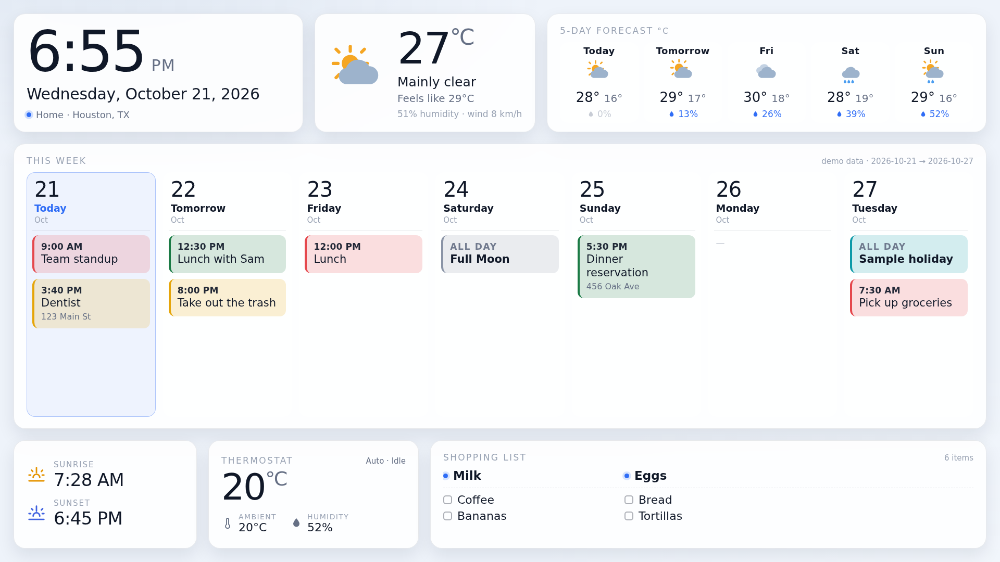
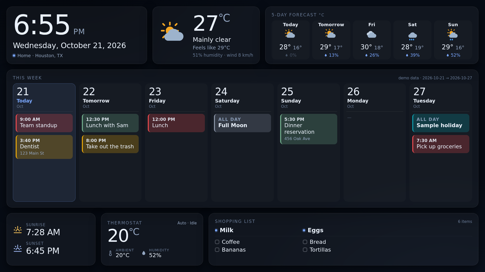

# Monitor

Tablero de pared de 1920x1080 (16:9), en inglés, con paleta clara desde el
amanecer y oscura desde el atardecer. Sin dependencias: Python 3 estándar en el
servidor y HTML/CSS/JS sin librerías en la página.




*(Las capturas son con `--mock`: datos de ejemplo, nada real.)*

```
┌──────────────┬────────────────┬───────────────────────────────┐
│ Reloj        │ Clima ahora    │ Pronóstico de 5 días          │
│ Fecha        │ (grados C)     │ día · ícono · máx/mín · lluvia│
├──────────────┴────────────────┴───────────────────────────────┤
│ Semana completa: hoy + 6 días, con los eventos de cada calendario
│ (Today / Tomorrow / nombre del día, color por calendario)      │
├──────────────┬────────────────┬───────────────────────────────┤
│ Amanecer /   │ Termostato     │ Lista del Super (Todoist)     │
│ Anochecer    │ Nest           │ 2 primeros items + el resto   │
└──────────────┴────────────────┴───────────────────────────────┘
```

## Arrancar

```bash
cd ~/monitor
cp config.example.json config.json      # y ponle tus datos (ubicación, cuenta)
python3 calendar-config.py add-missing  # las direcciones iCal de tus calendarios
python3 server.py                  # http://0.0.0.0:8770
python3 server.py --port 8080
python3 server.py --mock           # datos de ejemplo, sin credenciales
python3 server.py --once           # imprime el JSON y sale
python3 tests/test_calendar_ics.py  # pruebas del calendario (sin red)
```

En la página, `?theme=day|night` fuerza la paleta (útil para probar o para un
kiosco que no debe cambiar de tema).

## De dónde salen los datos

| Zona | Fuente | Refresco |
|---|---|---|
| Clima actual, pronóstico, amanecer/anochecer | Open-Meteo (Houston, casa) | 10 min |
| Semana de calendario | **las direcciones iCal secretas de cada calendario** | 5 min |
| Lista del súper | Todoist API v1 (el proyecto que diga `config.json`) | 5 min |
| Termostato | Google SDM (Nest) | 2 min |

**El calendario es solo de consulta.** El tablero lee los feeds `.ics` y nada
más: no da de alta, no modifica y no borra eventos. Y como lee la dirección
secreta de cada calendario, no hay OAuth de Google de por medio ni token que se
venza cada semana (el mismo truco del plugin de calendario de Omarchy).

Cada fuente falla sola: si una se cae, el tablero sigue vivo y en su tarjeta
aparece el motivo en una línea. Nunca se inventan datos.

La página se refresca cada 60 s y se escala sola de 1920x1080 a la pantalla que
la muestre (kiosco, tablet, TV). El reloj se actualiza cada segundo.

## Los calendarios — `calendars.json`

Cada calendario de Google tiene su **"Dirección secreta en formato iCal"**
(Google Calendar → Configuración → tu calendario → *Dirección secreta en formato
iCal*): termina en `/private-XXXXXXXX/basic.ics` y **quien la tenga puede leer el
calendario**. Por eso viven en `calendars.json` (chmod 600), separadas de
`config.json`, y nunca se imprimen en la pantalla ni en los logs.

```bash
cd ~/monitor

# sin --url la pide sin mostrarla en pantalla (no queda en el historial)
python3 calendar-config.py add --name "Home" --account me@example.com
python3 calendar-config.py add --name "Trabajo" --color "#e0533d"
python3 calendar-config.py list       # qué hay (la dirección va enmascarada)
python3 calendar-config.py check      # prueba cada URL y cuenta eventos de la semana
python3 calendar-config.py color --name "Home" --color "#2f6df6"
python3 calendar-config.py remove --name "Home"
python3 calendar-config.py seed       # (re)poner los feriados públicos
python3 calendar-config.py restore <respaldo> [--skip "A,B"]   # recuperar sin teclear

# si tienes a mano el config.json del plugin de Omarchy ya configurado:
python3 calendar-config.py import-omarchy /ruta/config.json
```

Los calendarios públicos (feriados, fases de la luna) no necesitan dirección
secreta: la pública `/public/basic.ics` sirve igual. También acepta
`webcal://…` (los feeds publicados de iCloud); el lector lo cambia a `https://`
al bajarlo. Y `add` se niega a guardar una dirección que ya tiene otro
calendario: dos entradas con la misma URL pintan lo mismo y una queda vacía.

`add-missing` propone los nombres de `calendar-config.py` (`REQUIRED_NAMES`) y
toma la cuenta de `calendar.defaultAccount` en `config.json`. Los feriados
públicos (Estados Unidos y México) se ponen solos, sin preguntar: su dirección es
pública.

Lo que resuelve la lectura por iCal (librería `ics_lib.py`, solo stdlib, heredada
del plugin de Omarchy):

- **Repeticiones**: expande RRULE (diaria, semanal, mensual, anual, BYDAY,
  COUNT, UNTIL) dentro de la ventana de la semana, con EXDATE y excepciones.
- **Eventos de varios días**: aparecen en cada día que cubren.
- **Cancelados y declinados**: no se pintan.
- **Un feed roto no tumba la semana**: su nombre aparece en la nota del
  encabezado (`1 calendar failing: …`) y los demás siguen.
- **Colores**: el `.ics` no trae color, así que el de cada calendario se fija en
  `calendars.json` (`--color`), y es el que pinta la barra y el fondo del evento.

## El termostato — `nest-setup.py`

La API de Nest es **Google Device Access (SDM)**: cuesta USD 5 una vez por cuenta
y el Project ID ya está en `config.json`. El `deviceId` no se ve en ninguna
consola: sale de la llamada `devices.list`, y para preguntarla hay que autorizar
primero. **Conectado el 21-oct-2026** (un solo termostato: ambiente, target y
humedad llegando). El script hace el camino completo:

```bash
python3 nest-setup.py status                                   # qué falta
python3 nest-setup.py client --json ~/Downloads/client_secret_XXXX.json
python3 nest-setup.py url                                      # abrir y aceptar permisos
python3 nest-setup.py code "https://www.google.com?code=..."    # guarda refresh token
python3 nest-setup.py devices                                   # lista y guarda el deviceId
```

Detalle que costó un intento: el redirect tiene que ser **el registrado en el
cliente**, no el que documenta Google. Este cliente tiene `https://google.com`
(sin `www`) y con `https://www.google.com` el canje muere en
`redirect_uri_mismatch`; `nest-setup.py` lee los redirects del JSON y usa el que
sí está registrado. Y en el proyecto de Device Access el **OAuth client ID** debe
ser el mismo cliente (se edita en la consola del proyecto; si no coincide, la
pantalla de permisos responde «Can't link to …» y no deja autorizar).

Lo que hay que tener en Google Cloud (una vez):

1. **Smart Device Management API** habilitada en el proyecto.
2. Cliente OAuth de tipo **Web application** con `https://www.google.com` como
   *Authorized redirect URI* (un cliente "Desktop" no sirve para esto).
3. Ese **Client ID capturado en el proyecto de Device Access**
   (`console.nest.google.com/device-access`) — se pide al crear el proyecto.

Con eso, la tarjeta muestra temperatura ambiente, target y humedad relativa. Sin
eso dice «Nest sin configurar» y el resto del tablero funciona igual.

Ojo: si el cliente OAuth está en modo *Testing*, el refresh token del Nest también
caduca a los 7 días. Publicar la app (*OAuth consent screen* → **Publish app**)
lo deja estable.

## Configuración — `config.json`

```jsonc
{
  "location": { "label": "Home · Houston, TX", "lat": 29.7604,
                "lon": -95.3698, "timezone": "America/Chicago" },
  "week":     { "days": 7, "startOffset": 0, "forecastDays": 5,
                "forecastStartsToday": true },
  "calendar": { "configFile": "~/monitor/calendars.json",
                "defaultAccount": "me@example.com" },
  "todoist":  { "tokenFile": "~/.todoist.cred", "project": "Shopping List",
                "pinnedCount": 2 },
  "nest":     { "enabled": false, "projectId": "<uuid del proyecto>", "deviceId": "",
                "refreshTokenFile": "~/.hermes/nest_token.json" }
}
```

- `calendar.defaultAccount` es la cuenta que se propone al dar de alta calendarios.
- `week.forecastStartsToday: false` hace que el pronóstico empiece mañana.
- `todoist.pinnedCount: 2` son los primeros items de la lista, que se muestran
  aparte y sin casilla, arriba del resto.

## Credenciales

| Qué | Dónde |
|---|---|
| Direcciones iCal de los calendarios | `~/monitor/calendars.json` (600) |
| Todoist | `~/.todoist.cred` (`api_token=…`, 600) |
| Nest (cliente OAuth + refresh token) | `~/.hermes/nest_client.json`, `~/.hermes/nest_token.json` (600) |

Ningún valor se imprime en el tablero ni en los logs.

## Producción: la Pi de la pared

**Regla:** todo se edita y se prueba aquí, en TheGrid2 (`~/monitor`). La Pi es
solo la copia que está en la pared; no se toca a mano.

| Pieza | Dónde |
|---|---|
| Servidor | servicio **de usuario** `monitor.service` (`systemctl --user`), con `loginctl enable-linger <usuario>` para que arranque sin que nadie inicie sesión |
| Pantalla | `~/start_chromium.sh`, lanzado por el autostart de LXDE (el de usuario manda: `~/.config/lxsession/LXDE-pi/autostart`) |
| Credenciales | `~/.todoist.cred` y `~/.hermes/nest_token.json`, ambos en `600` |

Publicar un cambio:

```bash
cd ~/monitor
./deploy/push-to-monitor.sh --dry-run   # qué cambiaría
./deploy/push-to-monitor.sh             # copia, reinicia y verifica
```

El script hace `rsync` del proyecto, copia las credenciales y el script del
kiosco, reinicia el servicio y no canta victoria hasta que `/api/data` contesta
con las cuatro fuentes en verde.

**Recarga sin tocar la Pi:** `/api/data` publica un campo `version` con la huella
de `web/`; la página lo compara en cada refresco y se recarga sola cuando cambia.
Así un cambio de HTML/CSS/JS llega a la pantalla en menos de un minuto sin
reiniciar el navegador.

En la Pi, el kiosco se lanza así (lo que hace `start_chromium.sh`):

```bash
sudo -u pi chromium-browser --kiosk --noerrdialogs --disable-infobars \
  --disable-session-crashed-bubble --overscroll-history-navigation=0 \
  --check-for-update-interval=31536000 --password-store=basic \
  http://localhost:8770/
```

`--password-store=basic` no es adorno: sin eso Chromium pide crear un llavero de
GNOME y el diálogo se planta encima del tablero al arrancar.

## Archivos

| Archivo | Qué es |
|---|---|
| `server.py` | servidor HTTP + recolección de datos (solo stdlib) |
| `ics_lib.py` | lectura de `.ics`, repeticiones y zonas horarias (solo stdlib) |
| `calendar-config.py` | alta/listado/prueba de los calendarios iCal |
| `nest-setup.py` | autorización SDM y búsqueda del `deviceId` |
| `config.json` | ubicación, semana, Todoist, Nest |
| `calendars.json` | las direcciones secretas (600, no se versiona) |
| `web/` | el tablero (`index.html`, `style.css`, `app.js`) |
| `tests/test_calendar_ics.py` | pruebas con un feed fixture (sin red) |
| `test_theme.py`, `test_data.py` | bancos de prueba con datos movidos a propósito |
| `deploy/` | unidad systemd y arranque de kiosco |

## Pruebas hechas

- `tests/test_calendar_ics.py`: 5 pruebas en verde — la repetición semanal cae en
  el día correcto, el evento de 3 días aparece en sus 3 días, EXDATE/cancelado/
  declinado no se pintan, un feed roto no tumba la semana, y la ventana es de 7 días.
- Feeds reales de Google (`Holidays in United States`, `Holidays in Mexico`):
  34 y 22 eventos leídos en 400 días, con las repeticiones anuales correctas.
- Render en Chromium a 1920x1080 con un feed fixture: los eventos caen en su
  columna y el color del calendario pinta la barra.
- Cambio de paleta automático: con el anochecer 2 minutos atrás la página queda
  `night`; con el anochecer en el futuro, `day` (sin usar `?theme=`).
- Lista con 22 items (`test_data.py bigshop`): se muestran los que caben y el
  encabezado dice cuántos van, sin recortar en silencio.
